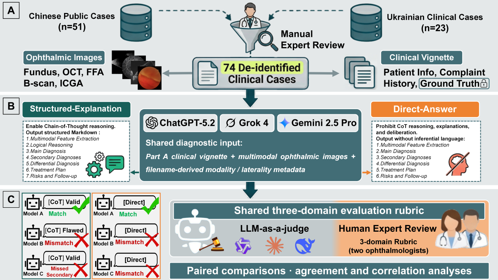
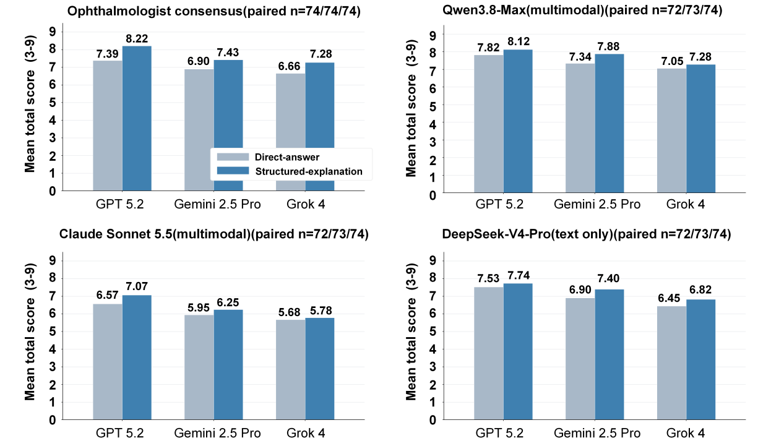
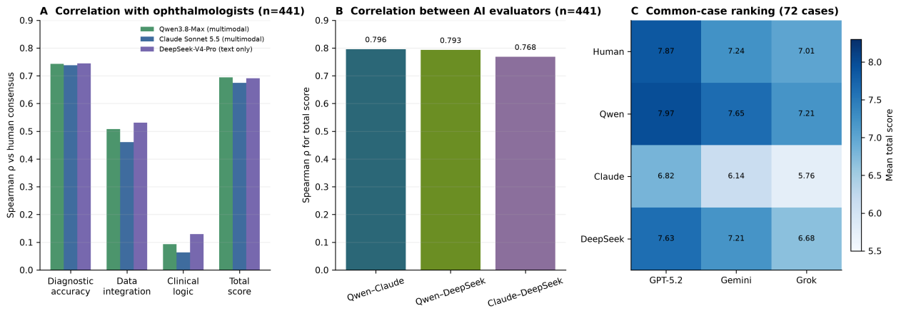
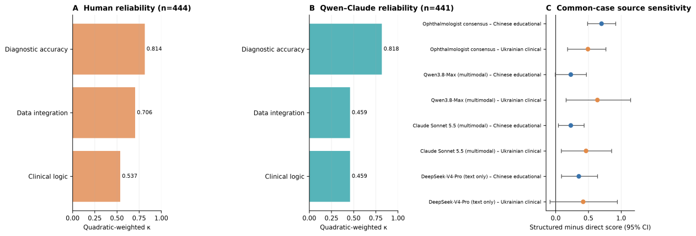
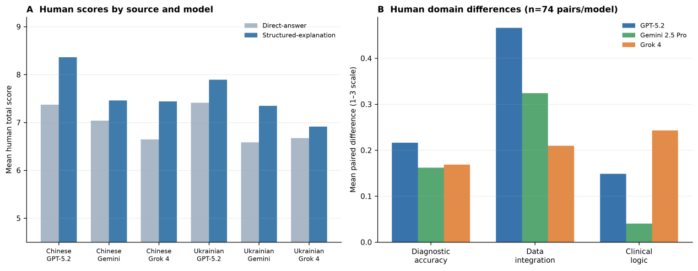

# OphthoMultiModalReason

**Open-Ended Multimodal Benchmark for Evaluating Clinical Response Quality of Large Language Models in Ophthalmology Cases**

A retrospective benchmark comparing three multimodal large language models under two fixed prompt packages. Two ophthalmologists and independent AI evaluators assess the responses using a common three-domain clinical rubric.

| Cases | Diagnostic models | Prompt packages | Human-rated responses | Responses available to each AI evaluator |
| :---: | :---: | :---: | :---: | :---: |
| 74 | 3 | 2 | 444 | 441 |

[Study overview](#study-overview) · [Results](#results-at-a-glance) · [Analysis populations](#analysis-populations) · [Installation](#installation) · [Workflow](#reproduction-workflow) · [Data availability](#data-availability)

## Study overview

[](assets/figures/Figure1_workflow.png)

*Figure 1. Evaluation workflow. The benchmark comprises 51 public Chinese educational cases and 23 contributed Ukrainian clinical cases. Two ophthalmologists scored all 444 responses. Independent AI evaluation used the 441 responses recoverable from the archive.*

The two prompt packages require either **structured explanation** or **direct answers**. They differ in both explanation instructions and output structure. Their comparison therefore concerns the complete prompt packages, rather than an isolated effect of internal reasoning.

All evaluators use the same three domains:

- **Diagnostic Accuracy**
- **Data Integration and Key Information Recognition**
- **Clinical Logic**

Each domain is scored from **1 to 3**, giving a total score of **3–9**. Human-consensus scores may include half-point increments when the two ophthalmologists differ by one point.

| Role | Models or evaluators | Input |
| --- | --- | --- |
| Diagnostic response generation | GPT-5.2, Gemini 2.5 Pro, Grok 4 | Clinical vignette and ophthalmic images |
| Primary clinical reference | Two ophthalmologists | Vignette, reference diagnosis, model response, and images |
| Independent multimodal evaluation | Qwen3.8-Max, Claude Sonnet 5.5 | Vignette, reference diagnosis, model response, and images |
| Text-only sensitivity evaluation | DeepSeek-V4-Pro | Vignette, reference diagnosis, and model response; no images |

See [evaluator configurations](OphthoMultiModalReason/configs/final_evaluator_panel.json) for model identifiers and decoding settings. Evaluator scores are analyzed separately.

## Results at a glance

The figures below are taken from the revised manuscript. Click a figure to view the full image.

### Scores under the two prompt packages

[](assets/figures/Figure3_prompt_package_scores.png)

*Figure 3. Mean total scores within each model's paired records: 74 case pairs per model for human consensus, and 72 GPT-5.2, 73 Gemini 2.5 Pro, and 74 Grok 4 case pairs for each automated evaluator. Qwen and Claude received images; DeepSeek received text only.*

Prompt-package differences depended on both the diagnostic model and the evaluator. For GPT-5.2, the structured-explanation minus direct-answer mean difference was **+0.831** under human consensus, **+0.306** under Qwen, and **+0.500** under Claude.

### Evaluator associations and descriptive model ordering

[](assets/figures/Figure4_evaluator_associations.png)

*Figure 4. Panels A and B use 441 records available for automated evaluation. Panel C uses 72 cases with complete records across all models and prompt packages, corresponding to 432 responses.*

Total-score Spearman correlations with human consensus were **0.694** for Qwen, **0.674** for Claude, and **0.691** for text-only DeepSeek. Associations were stronger for Diagnostic Accuracy and weaker for Clinical Logic.

On the common 72-case subset, mean total scores followed the same descriptive order for every evaluator: **GPT-5.2, Gemini 2.5 Pro, then Grok 4**. No pairwise between-model significance test was performed.

<details>
<summary><strong>Figure 5 — Reliability and source-stratified sensitivity</strong></summary>

[](assets/figures/Figure5_reliability_source_sensitivity.png)

*Figure 5. Human inter-rater reliability uses all 444 responses rated by both ophthalmologists; Qwen–Claude reliability uses 441 records. Source-stratified prompt-package differences use the common 72 cases: 49 Chinese educational and 23 Ukrainian clinical cases.*

</details>

<details>
<summary><strong>Figure 6 — Human scores by model, prompt package, and case source</strong></summary>

[](assets/figures/Figure6_human_scores.png)

*Figure 6. Panel A shows mean human-consensus total scores separately for Chinese educational cases (n = 51) and Ukrainian clinical cases (n = 23). Panel B shows mean paired domain-score differences, structured-explanation minus direct-answer, across all 74 cases per model. Domain scores range from 1 to 3; positive differences favor structured explanation.*

</details>

Human review was not fully masked to model identity or prompt package. Independent evaluator prompts omitted explicit model and prompt-package labels, but response structure could still reveal the prompt package. The benchmark does not establish a causal effect of reasoning or performance in routine clinical deployment.

## Analysis populations

Three previously physician-rated response texts from two cases were unavailable in the archive used for automated reevaluation. The completed physician ratings were retained. Missing responses were neither regenerated nor assigned substitute scores.

| Analysis | Population in the revised manuscript |
| --- | --- |
| Human scoring and human inter-rater reliability | 74 cases; 444 responses |
| Human paired prompt-package comparisons | 74 case pairs per diagnostic model |
| Human–AI and AI–AI associations | 441 available response records |
| Automated paired prompt-package comparisons | GPT-5.2: 72 pairs; Gemini 2.5 Pro: 73 pairs; Grok 4: 74 pairs |
| Cross-evaluator descriptive model ordering | 72 common cases; 432 responses |
| Common-case source-stratified prompt contrasts | 49 Chinese educational and 23 Ukrainian clinical cases |
| Public-source sensitivity analysis using human consensus | 51 Chinese vs. 23 Ukrainian cases; retinal detachment subset: 9 vs. 15 |

The public-source sensitivity analysis examines observable source-associated score differences. It cannot establish the presence or absence of proprietary training-set overlap.

## Code status

The public scripts currently implement a **complete-cohort workflow**: task preparation expects 444 responses, and `analyze_full_results.py` requires all 74 cases and 444 records for every evaluator. These checks do **not yet implement the revised manuscript's 441-record automated analyses or its analysis-specific paired populations**.

The commands below document that existing workflow. Reproducing the revised manuscript's numerical results requires the corresponding archived data and an analysis implementation that handles the three documented exclusions. Do not fill the missing records or remove completeness checks merely to make the scripts run.

## Installation

The executable project is inside the repository's `OphthoMultiModalReason/` subdirectory. From a fresh clone:

```bash
git clone https://github.com/OpenMedAILab/OphthoMultiModalReason.git
cd OphthoMultiModalReason/OphthoMultiModalReason

python -m venv .venv
source .venv/bin/activate
python -m pip install -r requirements.txt
```

On Windows PowerShell, activate the environment with `.venv\Scripts\Activate.ps1`.

For paid runs, create a local `.env` in that project directory with the credentials and endpoints required by the selected provider:

```dotenv
OPENROUTER_API_KEY=YOUR_OPENROUTER_API_KEY
OPENROUTER_BASE_URL=https://openrouter.ai/api/v1
BAILIAN_TOKEN_PLAN_API_KEY=YOUR_BAILIAN_API_KEY
BAILIAN_TOKEN_PLAN_URL=YOUR_PROVIDER_BASE_URL
```

Replace the placeholders locally. Do not upload `.env` or API credentials. Paid calls also require the explicit `--confirm-paid-run` flag.

## Quick smoke test

Run from the project subdirectory:

```bash
python -m unittest discover -s tests -v
python scripts/generate_responses.py \
  --dataset examples/synthetic_dataset \
  --dry-run
```

These commands use the synthetic fixture and do not make paid inference calls.

## Reproduction workflow

The following commands target the current complete-cohort implementation described in [Code status](#code-status). Running generation again produces a new set of responses; it does not recover the historical responses assessed by the ophthalmologists.

### 1. Generate diagnostic responses

```bash
python scripts/generate_responses.py \
  --dataset data/Dataset_74 \
  --output outputs/evaluation_results_full.json \
  --confirm-paid-run
```

The script submits all images for one case in one request, uses temperature 0.1, and saves each successful response. The two diagnostic prompt templates are implemented in [generate_responses.py](OphthoMultiModalReason/scripts/generate_responses.py).

### 2. Prepare independent same-rubric evaluation tasks

```bash
python scripts/rescore_same_rubric.py prepare \
  --results outputs/evaluation_results_full.json \
  --dataset data/Dataset_74 \
  --rater1 data/human_scores_rater1.xlsx \
  --rater2 data/human_scores_rater2.xlsx \
  --output data/revision_judge

python scripts/rescore_same_rubric.py validate \
  --output data/revision_judge
```

Evaluator prompts omit explicit diagnostic-model and prompt-package labels. This is not a claim of complete masking, because the response content and structure remain visible.

### 3. Run independent evaluators

```bash
# Qwen3.8-Max: multimodal
python scripts/rescore_same_rubric.py run \
  --output data/revision_judge \
  --provider bailian-token-plan \
  --judge-model qwen3.8-max \
  --run-label qwen_full \
  --thinking-mode disabled \
  --image-detail high \
  --confirm-paid-run

# Claude Sonnet 5.5: multimodal
python scripts/rescore_same_rubric.py run \
  --output data/revision_judge \
  --provider openrouter \
  --judge-model anthropic/claude-sonnet-5.5 \
  --run-label claude_full \
  --reasoning-effort medium \
  --image-detail high \
  --confirm-paid-run

# DeepSeek-V4-Pro: text-only sensitivity evaluation
python scripts/rescore_same_rubric.py run \
  --output data/revision_judge \
  --provider bailian-token-plan \
  --judge-model deepseek-v4-pro \
  --run-label deepseek_text_full \
  --input-mode text-only \
  --thinking-mode disabled \
  --confirm-paid-run
```

The [single-run mapping](OphthoMultiModalReason/configs/single_run_map.example.json) matches these example labels. The [archived run mapping](OphthoMultiModalReason/configs/published_run_map.json) records the resumable run-directory layout.

### 4. Analyze a complete cohort

```bash
python analysis/analyze_full_results.py \
  --run-config configs/single_run_map.example.json

python analysis/analyze_source_sensitivity.py \
  --run-config configs/single_run_map.example.json

python analysis/build_figures.py \
  --run-config configs/single_run_map.example.json
```

These commands require local study inputs and evaluator outputs; the public repository does not include them. The current analysis scripts are not a drop-in reproduction path for the revised 441-record archive.

## Repository map

Paths below are relative to the executable project subdirectory.

| Path | Purpose |
| --- | --- |
| [`scripts/generate_responses.py`](OphthoMultiModalReason/scripts/generate_responses.py) | Fixed prompt packages and diagnostic response generation |
| [`scripts/rescore_same_rubric.py`](OphthoMultiModalReason/scripts/rescore_same_rubric.py) | Task preparation, validation, and independent evaluator execution |
| [`analysis/analyze_full_results.py`](OphthoMultiModalReason/analysis/analyze_full_results.py) | Current complete-cohort score and association analysis |
| [`analysis/analyze_source_sensitivity.py`](OphthoMultiModalReason/analysis/analyze_source_sensitivity.py) | Source-associated performance sensitivity analysis |
| [`analysis/build_figures.py`](OphthoMultiModalReason/analysis/build_figures.py) | Figure and local analysis-workbook generation |
| [`docs/data_schema.md`](OphthoMultiModalReason/docs/data_schema.md) | Local input formats |
| [`configs/`](OphthoMultiModalReason/configs/) | Evaluator settings and result-directory mappings |
| [`tests/`](OphthoMultiModalReason/tests/) | Offline unit and smoke tests |
| [`examples/`](OphthoMultiModalReason/examples/) | Synthetic non-clinical fixture |

The displayed manuscript figures are stored in [`assets/figures/`](assets/figures/) at the repository root.

## Data availability

This repository provides code, configuration metadata, schemas, tests, a synthetic example, and the manuscript workflow and aggregate result figures displayed above.

The clinical case dataset, source documents, individual clinician-rating files, full diagnostic responses, evaluator rationales, manuscripts, reviewer correspondence, and API credentials are not included. The case-level comparison in manuscript Figure 2 is not included in this homepage package.

Authorized users can organize their local inputs using [the data schema](OphthoMultiModalReason/docs/data_schema.md). Availability of de-identified study data remains subject to the arrangements described in the accompanying manuscript. Public-source articles and clinical imaging datasets are not distributed as benchmark inputs through this repository.

## License

A code license has not yet been selected. See [`LICENSE_PENDING.md`](OphthoMultiModalReason/LICENSE_PENDING.md) for the current status.

## Citation

Please cite the accompanying manuscript:

> **Open-Ended Multimodal Benchmark for Evaluating Clinical Response Quality of Large Language Models in Ophthalmology Cases.**

Machine-readable citation metadata are provided in [`CITATION.cff`](OphthoMultiModalReason/CITATION.cff). Journal and DOI fields should be updated after publication.

